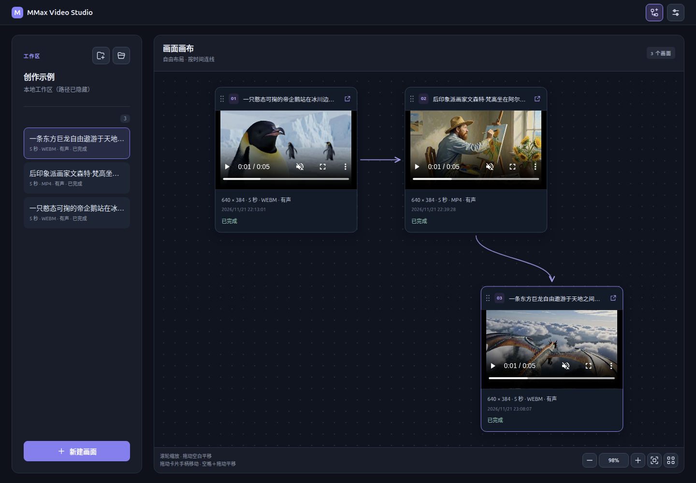
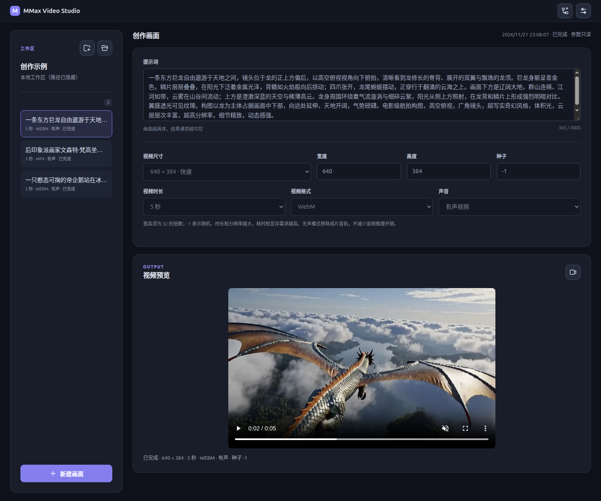
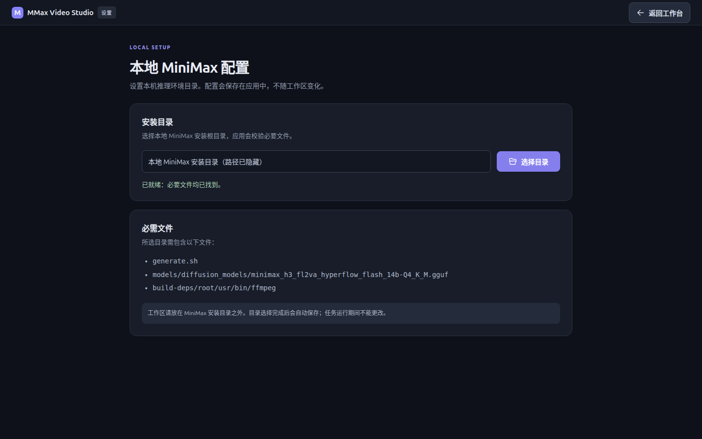

# MMax Video Studio

[](https://github.com/luskyle/mmax-video/actions/workflows/ci.yml)
[](https://github.com/luskyle/mmax-video/actions/workflows/pages.yml)

**在本机生成视频，在自由画布上组织灵感。**

调用本地 MiniMax H3 的 Electron 桌面工作台：独立创作画面、视频预览、二维可缩放画布，
以及按工作区管理的提示词、参数和成片。生成结果保存在工作区，不写入模型安装目录。

[项目展示](https://luskyle.github.io/mmax-video/) ·
[下载最新版](https://github.com/luskyle/mmax-video/releases/latest) ·
[版本说明](docs/releases/v1.0.1.md)

> 当前支持 **Linux x64 桌面环境**。MiniMax 模型、推理器、CUDA 和 FFmpeg 需另行部署，
> 不包含在安装包中；GitHub Pages 是展示网站，不能在网页上执行本地 GPU 推理。

## 实际效果

截图来自现有工作区中真实生成的企鹅、画室和巨龙成片，不是占位图；本地路径已隐藏。

### 自由画布

滚轮缩放、拖动平移、自由移动卡片；箭头保留创作时间顺序，卡片内可直接播放视频。



### 创作与预览

每个画面保留自己的提示词、时长、尺寸、格式及音频选项，历史画面随时回看。



<details>
<summary>本地 MiniMax 设置页面</summary>



</details>

## 下载安装

### Linux x64 发布包

在 [Releases](https://github.com/luskyle/mmax-video/releases/latest) 下载所需格式及 `SHA256SUMS`。
Debian / Ubuntu 推荐使用 deb 包，安装时会由 apt 处理系统依赖。以 v1.0.1 为例：

```bash
sha256sum --ignore-missing --check SHA256SUMS
sudo apt install ./mmax-video-studio_1.0.1_amd64.deb
mmax-video-studio
```

卸载使用 `sudo apt remove mmax-video-studio`。deb 不创建应用菜单图标，工作区和用户配置不会随卸载删除。
也可以下载免安装压缩包：

```bash
sha256sum --ignore-missing --check SHA256SUMS
tar -xzf mmax-video-studio-1.0.1-linux-x64.tar.gz
cd mmax-video-studio-1.0.1-linux-x64
./mmax-video-studio
```

发布包自带 Electron 运行时，无需另外安装 Node.js/npm。需要 Linux 图形桌面及 Electron 所需系统库，
推荐 Ubuntu 22.04 或更新版本；中文字体可安装 `fonts-noto-cjk`。不支持以 root 身份运行，
也不建议用 `--no-sandbox` 绕过系统沙箱限制。暂未发布 Windows、macOS 或 ARM 版本。

### 从源码启动

使用系统安装的 **Node.js 22.12+** 和 npm，推荐 Node.js 24 LTS。不再依赖项目内额外下载的 Node 工具链。

```bash
git clone https://github.com/luskyle/mmax-video.git
cd mmax-video
npm ci
npm run install:electron
npm start
```

也可以运行 `bash run.sh`。

Electron 下载受网络影响时可使用
`ELECTRON_MIRROR=https://npmmirror.com/mirrors/electron/ npm run install:electron`。
需要 Linux 图形桌面。首次启动后，点击「设置」并选择包含
`generate.sh`、模型文件和 `build-deps/root/usr/bin/ffmpeg` 的安装目录；选择会保存在应用设置中。
模型和推理器不包含在本项目中。

## 使用

1. 先在右上角「设置」中选择 MiniMax 本地目录，再点击左侧栏的「新建工作区」图标，输入名称并选择**父目录**；应用创建新的工作区文件夹。
   也可以用左侧栏的「打开工作区」图标选择已有的工作区文件夹。工作区不能在 MiniMax 目录内。
2. 点击左侧栏底部的「新建画面」，输入提示词，选择尺寸或输入自定义宽高；
   尺寸必须是 256–1920 的 32 的倍数，`-1` 为随机种子。
   下拉选择 **5／10／15 秒**、**WebM／MP4** 和**有声／无声（仅画面）**。
   每个画面保存自己的生成选项，新画面使用工作区原有默认值，无需手动保存。
3. 点击「开始生成」后创建一条独立的创作记录。五彩光谱进度条随准备、采样、解码和导出阶段单向推进，
   不循环往返；同时显示已用时间和实际采样步数。条形长度表示阶段推进，不代表精确耗时百分比。
4. 点击左侧记录可切换到对应的创作页面，查看提示词、选项和结果；已提交的画面参数只读。
   「新建画面」打开新的创作草稿；浏览历史后再点击它可回到尚未提交的草稿。
   应用一次只生成一个画面，完成前不能新建画面、删除记录、切换工作区或关闭窗口，
   但可以浏览旧画面；进度区的「查看生成画面」可返回正在生成的页面。
5. 点击右上角的「切换到画布视图」图标，进入可自由平移、缩放的二维画布，不再使用横向滚动列表。
   画面初始按时间蛇形排列，箭头始终从较早的画面指向下一画面；拖动卡片左上角手柄可自由调整位置。
   滚轮或触控板捏合以鼠标位置为中心缩放，拖动空白区域平移；也可按住空格或鼠标中键拖动平移。
   底部工具栏提供缩小、放大、恢复 100%、适配全部和按时间重新排列。画布可向任意方向平移，
   缩放范围为 1%–1600%；聚焦画布后可用方向键平移、`+`／`-` 缩放、`0` 恢复 100%、`Home` 适配全部，
   聚焦卡片手柄后可用方向键移动卡片（按住 Shift 加快）。
   可直接播放成片；未完成或失败的画面显示对应状态。点击卡片标题返回该创作画面，
   再次点击视图按钮可返回原画面，未提交的草稿不会因切换视图丢失。
   生成过程中也能切换视图；刷新状态不会重建播放器或重置视角，离开视图时会暂停播放。
   手动布局和视角在本次打开工作区期间保留，切换工作区或重新启动后恢复自动布局。
6. 右键点击左侧记录或画布卡片，选择「删除创作记录」并确认，会永久删除该记录及对应视频、
   原始输出和日志，其他记录不受影响。生成期间禁用删除。

按钮配有图标和鼠标悬停提示，纯图标按钮保留无障碍名称，键盘 Tab 可显示焦点。
应用内部标识仍为 `mmax-video`，更名不会改变已有的应用配置目录或工作区格式。

每个工作区的 `.mmax-workspace.json` 保存设置；`jobs/<任务编号>/` 保存 `job.json`、
`generation.log`、生成的 `original.webm` 和成片 `video.webm` 或 `video.mp4`。
WebM 复制原始 VP8 视频流，有声模式将 PCM 音频转换为 Opus；MP4 将视频编码为
H.264，有声模式使用 AAC，便于兼容常见播放器。无声成片不包含音轨。
当前 H3 推理流程仍会生成音频，无声选项在导出时移除音轨，不节省音频推理开销；
保留的 `original.webm` 仍是含原始音频的诊断输出。
界面不显示日志按钮；诊断日志仍保留在工作区。任务失败时日志和可能的部分文件也保留；异常退出后会标记未完成任务，
如果先前的进程仍在运行，则等待其退出后才可继续。
旧工作区和记录仍可读取，缺少的新选项按 5 秒、WebM、有声处理，不修改旧视频。

应用使用本机 `generate.sh`、CUDA 和 HyperFlow H3 Flash Q4 模型，固定 6 步、
24 fps。H3 帧数必须满足 `17n+5`：5／10／15 秒分别请求 124／243／362 帧，
随后裁剪成片到所选时长（音频编码可能带来毫秒级封装时差）。
当前 A2000 12GB 上曾在约 5 秒视频实测 640×384 约 4 分钟、
960×544 约 9 分钟、1088×608 约 12 分钟；高分辨率会增加显存消耗和耗时，
较长时长也会明显增加开销，可能失败，并不保证所有尺寸和时长组合都能运行。
模型可能生成错误的文字、数字或运动。
运行期间尽量避免同时从其他程序启动 GPU 推理。视频和音频保留在所选工作区，
应用自身的上次工作区路径由 Electron 存在系统应用设置目录。

## 开发与验证

```bash
npm run check
npm test
npm run package:linux
npm run test:smoke
npm run test:deb
```

`package:linux` 只在 Linux x64 上运行，将应用、Electron 运行时、第三方许可和说明文档打包到 `dist/`，
同时生成 `.tar.gz`、`.deb` 和 SHA-256 校验文件；不会打包工作区、模型、用户配置或依赖开发工具。
`test:smoke` 启动打包后的真实应用，使用独立临时工作区验证画布、缩放、拖拽、草稿和设置页面，
不会触发 GPU 推理。`test:deb` 在隔离目录测试 dpkg 安装、启动和卸载，不修改系统软件包。
无图形会话时分别使用 `xvfb-run -a npm run test:smoke` 和 `xvfb-run -a npm run test:deb`。

## CI / CD 与 GitHub Pages

| 流程 | 触发条件 | 内容 |
| --- | --- | --- |
| [CI](.github/workflows/ci.yml) | 推送 `main`、Pull Request、手动触发 | Node.js 22/24 语法检查与测试；Linux x64 打包、真实 Electron 冒烟测试、校验文件及构建产物 |
| [GitHub Pages](.github/workflows/pages.yml) | `main` 上的展示文档变更、手动触发 | 将 `docs/` 静态展示站部署到 GitHub Pages |
| [Release](.github/workflows/release.yml) | 推送 `v*` 标签 | 校验版本与说明，测试、打包并验证，再发布包含应用包和 `SHA256SUMS` 的 GitHub Release |

仓库的 **Settings → Pages → Source** 使用 **GitHub Actions**，不需要维护单独的 `gh-pages` 分支。
发布新版本时，先同步 `package.json` / `package-lock.json` 中的版本号，
在 `docs/releases/vX.Y.Z.md` 编写版本说明，再提交并推送对应标签：

```bash
git tag -a vX.Y.Z -m "MMax Video Studio vX.Y.Z"
git push origin main
git push origin vX.Y.Z
```

标签必须与应用版本一致。Release 只有在构建与桌面冒烟测试通过后才会公开；
发布流程使用仓库自带的 `GITHUB_TOKEN`，无需额外存储发布密钥。

模型及推理部署细节和许可证请参阅所选 MiniMax 安装目录中的 README 及上游项目。
发布包保留 `LICENSE.electron` 与 `LICENSES.chromium.html`，它们仅对应所附第三方运行时。
