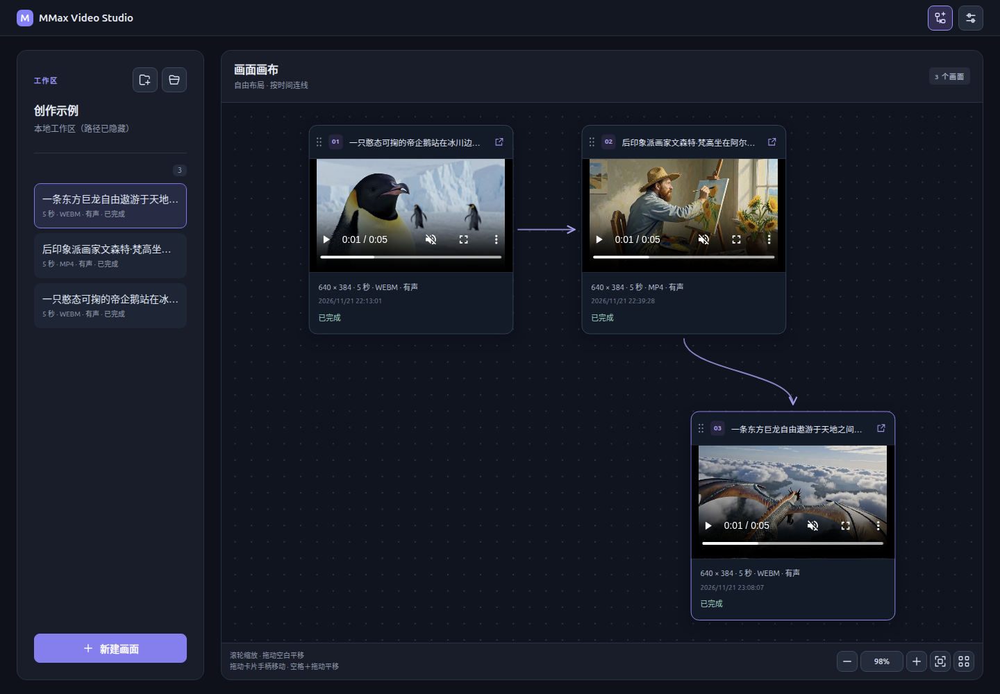

# MMax Video Studio v1.0.0

首个正式版本：一个调用本地 MiniMax H3 的 Linux 视频创作工作台，让独立画面、视频预览与自由画布连成完整工作流。



## 本次发布

- **自由画布**：二维平移、鼠标位置缩放、卡片拖拽、自动时间顺序连线，以及恢复 100%、适配全部、重新排列。支持鼠标、触控板与键盘。
- **独立创作画面**：每条记录保存提示词、参数和结果；浏览历史时保留未提交草稿，支持右键确认删除。
- **完整视频选项**：5 / 10 / 15 秒，WebM / MP4，有声 / 无声，以及自定义尺寸和随机种子。
- **光谱进度显示**：按准备、采样、解码、导出实际阶段单向推进，显示采样步数与已用时间；不会伪装成精确耗时百分比。
- **本地设置页面**：配置并检查 MiniMax 安装目录，模型与工作区分离；生成期间防止新建画面、删除记录或切换工作区。
- **紧凑桌面 UI**：图标、悬停提示与键盘焦点；旧工作区和旧 WebM 记录保持兼容。
- **发布与自动化**：Linux x64 应用包、SHA-256 校验文件、真实工作区截图、GitHub Pages 展示站，以及 CI / CD。
- **运行时更新**：使用 Electron 45.4.1，替换旧运行时及其存在已知漏洞的安装依赖；源码启动使用系统 Node.js。

## 下载与运行

下载本页 Assets 中的：

1. `mmax-video-studio-1.0.0-linux-x64.tar.gz`
2. `SHA256SUMS`

将它们放在同一目录，然后运行：

```bash
sha256sum --check SHA256SUMS
tar -xzf mmax-video-studio-1.0.0-linux-x64.tar.gz
cd mmax-video-studio-1.0.0-linux-x64
./mmax-video-studio
```

应用包包含 Electron，无需另外安装 Node.js。首次启动后，在设置中选择本地 MiniMax 目录，再创建工作区。
源码用户使用 Node.js 22.12+（推荐 24 LTS），依次运行 `npm ci`、`npm run install:electron` 和 `npm start`。

## 适用范围与已知限制

- 当前发布 **Linux x64** 版本，需要图形桌面和 Electron 系统依赖，推荐 Ubuntu 22.04 或更新版本。不要以 root 运行，也不要通过禁用沙箱作为常规启动方式。
- **模型、推理器、CUDA 与 FFmpeg 不随应用打包**，需自行部署；应用目前使用 MiniMax H3 HyperFlow Flash Q4、CUDA、6 步采样及 24 fps。上游组件遵循各自许可。
- 时长和分辨率越高，显存需求越大；不保证每种组合都能在所有 GPU 上成功生成。
- 无声选项在导出时移除音轨，不减少音频推理开销；工作区保留的原始输出可能仍含音频。
- 画布缩放范围为 1%–1600%，平移不设边界。手动布局与视角在本次打开工作区期间保留，重新启动或切换工作区后恢复自动布局。
- GitHub Pages 是产品展示站，不是在线生成服务；没有远程上传视频或自动更新功能。
- 右键删除会永久删除该记录及其视频、原始输出和日志，请先备份需要保留的作品。

## 验证与发布流程

- 16 项单元及回归测试，覆盖生成参数、文件管理、进度解析和画布几何。
- CI 在 Node.js 22 / 24 上检查语法并执行测试。
- 发布前启动打包后的真实 Electron 应用，验证工作区、画布缩放与拖拽、场景切换、草稿及设置页面。
- 发布包附带 SHA-256 校验文件与第三方运行时许可；自动化测试使用独立临时工作区，不运行 GPU 推理。
- 展示截图来自已有工作区的真实生成成片，本地路径已隐藏。

[项目展示](https://luskyle.github.io/mmax-video/) · [使用指南](https://github.com/luskyle/mmax-video#readme) · [自动化流程](https://github.com/luskyle/mmax-video/actions)
